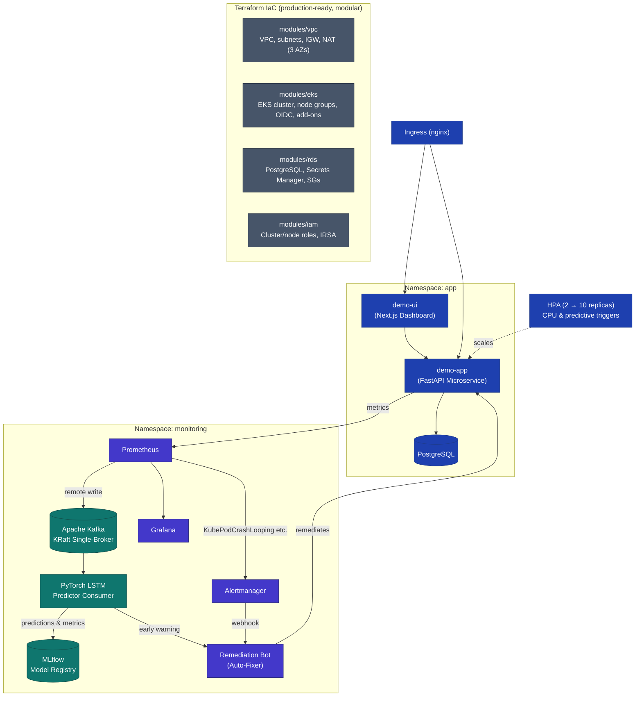

# Foresight — ML-Driven Predictive Self-Healing Platform

> A production-grade DevOps & MLOps portfolio project demonstrating Infrastructure as Code, Kubernetes, Real-time Streaming, LSTM Anomaly Forecasting, Next.js Observability Dashboard, and Automated Incident Remediation — running for **$0** on minikube.

---

## What This Project Does

1. **Provisions Infrastructure as Code** — Terraform modules for VPC, EKS, RDS, and IAM (production-ready, deployable to AWS).
2. **Runs Microservices & Web UI** — FastAPI backend app with non-root security and a Next.js dynamic dashboard for monitoring system health and executing chaos experiments.
3. **Streams Metrics in Real-time** — Prometheus metrics remote-written to Apache Kafka (KRaft mode) streaming topic.
4. **Predicts Failures before they happen** — PyTorch LSTM Neural Network processes live metric sequences to forecast incident likelihood 3–5 minutes ahead of threshold breaches.
5. **Tracks & Detects Model Drift** — Integrated MLflow server for experiment tracking, model registry, and Evidently-style Kolmogorov-Smirnov / PSI drift detection.
6. **Heals Itself Automatically** — Remediation Bot receives webhook alerts and predictive signals to auto-heal crash loops, memory pressure, and CPU spikes (cutting MTTR from 5+ minutes to <60s).

---

## Architecture



---

## Tech Stack

| Domain | Tech Stack |
|---|---|
| **Frontend UI** | Next.js 15, TypeScript, Vanilla CSS (Dark Mode & Micro-animations) |
| **Backend API** | FastAPI, Uvicorn, Python 3.12, PostgreSQL |
| **Machine Learning** | PyTorch (LSTM), MLflow, SciPy/NumPy (Drift Detection) |
| **Event Streaming** | Apache Kafka (KRaft mode, no ZooKeeper) |
| **Infrastructure & K8s** | Terraform, Kubernetes (Deployments, Services, HPA, PDB, Ingress), Helm |
| **Observability** | Prometheus, Grafana, Alertmanager, kube-state-metrics |
| **Automation & CI/CD** | Python Kubernetes SDK, GitHub Actions |

---

## Quick Start (5 commands)

```bash
# 1. Clone the repo
git clone https://github.com/navyabijoy/foresight.git
cd foresight

# 2. Build Docker images inside minikube
make build-minikube

# 3. Full stack setup (Kafka + MLflow + Prometheus + App + Next.js UI + Bot)
make install-all

# 4. Access UI & Dashboards
make port-ui         # → http://localhost:3000 (Next.js Dashboard)
make port-grafana    # → http://localhost:3000 (Grafana: admin / grafana-admin-pass)
make port-mlflow     # → http://localhost:5000 (MLflow UI)

# 5. Trigger Chaos / Predictive Self-Healing Demo!
# Use the buttons on the Next.js UI or run:
make simulate-crash
```

---

## Key Features & Demos

### Demo 1: Next.js Interactive Operations Dashboard
- Live API health, Database connection status, pod environment metadata.
- Interactive Chaos Engineering controls (`Simulate CPU Load` & `Trigger Pod Crash`).

### Demo 2: Predictive Incident Detection (PyTorch LSTM)
- Live metrics streaming to Kafka.
- LSTM consumer analyzes sliding window sequences of CPU, Memory, and Latency metrics.
- Predicts imminent failures before thresholds are crossed, sending early warnings.

### Demo 3: Self-Healing Crash Loop Remediation
1. Trigger pod failure via UI or `make simulate-crash`.
2. Alertmanager fires `KubePodCrashLooping` alert.
3. Remediation Bot receives webhook and automatically remediates the container.

---

## CI/CD Workflows

GitHub Actions workflows included in `.github/workflows/`:
- `app-build.yml` — Builds and scans FastAPI backend Docker image.
- `ml-build.yml` — Builds and validates ML training & streaming consumer containers.
- `retrain.yml` — Automated weekly model retraining & feature drift analysis pipeline.
- `terraform-validate.yml` — Lints and validates Terraform IaC code on pull requests.

---

## License

MIT.
