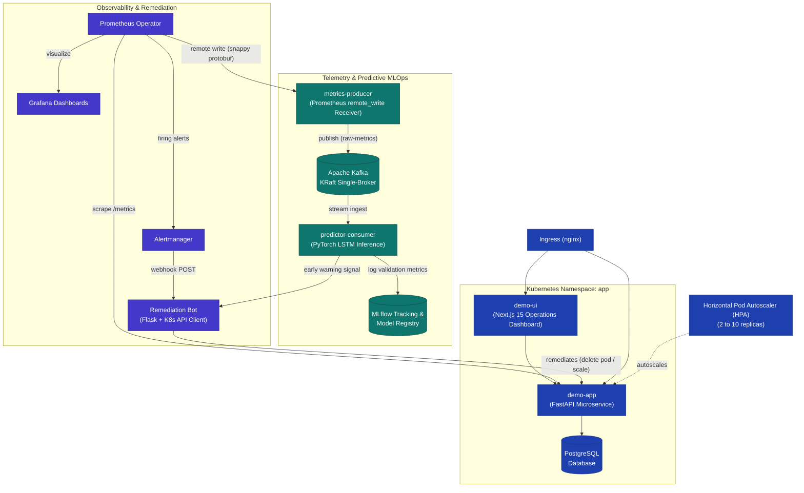

# Foresight — ML-Driven Predictive Self-Healing Platform

<div align="center">

[](https://opensource.org/licenses/MIT)
[](https://www.python.org/)
[](https://fastapi.tiangolo.com/)
[](https://nextjs.org/)
[](https://pytorch.org/)
[](https://kafka.apache.org/)
[](https://kubernetes.io/)
[](https://www.terraform.io/)
[](https://mlflow.org/)
[](https://prometheus.io/)

<p align="center">
  <b>An end-to-end cloud-native platform combining Infrastructure as Code, real-time event streaming, PyTorch LSTM failure forecasting, and automated Kubernetes remediation to slash Mean Time to Resolution (MTTR) from minutes to seconds.</b>
</p>

</div>

---

## 📑 Table of Contents

- [Overview](#-overview)
- [Reactive vs. Predictive Self-Healing](#-reactive-vs-predictive-self-healing)
- [System Architecture](#-system-architecture)
- [Core Components](#-core-components)
  - [1. Application & Dashboard Tier](#1-application--dashboard-tier)
  - [2. Streaming Telemetry Pipeline](#2-streaming-telemetry-pipeline)
  - [3. Predictive ML & MLOps Engine](#3-predictive-ml--mlops-engine)
  - [4. Automated Remediation Engine](#4-automated-remediation-engine)
  - [5. Infrastructure as Code & Orchestration](#5-infrastructure-as-code--orchestration)
- [Quick Start Guide](#-quick-start-guide)
  - [Cluster Mode (Minikube / Kubernetes)](#option-a-full-stack-on-minikube-zero-cloud-cost)
  - [Local Standalone Development Mode](#option-b-local-standalone-mode-no-kubernetes-required)
- [Interactive Chaos & Self-Healing Demos](#-interactive-chaos--self-healing-demos)
- [Repository Structure](#-repository-structure)
- [CI/CD Pipelines](#-cicd-pipelines)
- [License & Attribution](#-license--attribution)

---

## 🔭 Overview

Traditional site reliability engineering (SRE) relies on **reactive alerting**: metrics are scraped, thresholds are breached, alerts trigger, and an engineer or remediation script fixes the service after degradation has already begun.

**Foresight** shifts from reactive recovery to **predictive failure prevention**:
* Live telemetry is streamed directly from Prometheus to Apache Kafka.
* A deep learning LSTM neural network continuously analyzes sliding windows of system metrics to forecast anomalies **3–5 minutes before thresholds are breached**.
* The autonomous Remediation Bot receives early warnings and automatically repairs workloads (restarting crash-looping containers, scaling replica sets, or cordoning unhealthy nodes) — bringing **MTTR down from 5+ minutes to < 60 seconds**.

---

## ⚡ Reactive vs. Predictive Self-Healing

| Capability | Traditional Reactive SRE | Foresight Predictive Platform |
|---|---|---|
| **Incident Trigger** | Threshold breach occurs ($>90\%$ CPU, OOM Kill) | Telemetry trend indicates imminent breach 3–5 min ahead |
| **Data Ingestion** | Batch scraping every 15–30s | Continuous real-time streaming via Prometheus `remote_write` to Kafka |
| **Detection Method** | Static threshold / PromQL heuristics | Recurrent Neural Network (PyTorch 2-layer LSTM) |
| **Response Latency** | Alert firing window (typically 2–5 min) | Continuous sliding-window inference (~5ms per window) |
| **Model Governance** | Manual review or non-existent | Automated MLflow registry, precision thresholds, and KS/PSI drift checks |
| **MTTR Impact** | 5 to 15 minutes (post-outage) | **< 60 seconds** (preemptive or early remediation) |

---

## 🏛 System Architecture



---

## 🧩 Core Components

### 1. Application & Dashboard Tier
* **FastAPI Microservice (`app/`)**: Production-ready Python 3.12 backend containerized with multi-stage non-root builds. Automatically instruments request latencies and response codes, and exposes chaos hooks:
  * `POST /load?seconds=N`: Generates multi-core CPU load in background threads to trigger autoscaling and alerts.
  * `GET /crash`: Invokes `os._exit(1)` to simulate sudden process crashes and produce `CrashLoopBackOff` conditions.
  * `GET /health` & `GET /db`: Readiness probes and PostgreSQL smoke testing.
* **Next.js Operations Dashboard (`ui/`)**: Built on Next.js 15, React 19, and TypeScript. Provides real-time cluster pod status, environment details, and one-click chaos experiment buttons.

### 2. Streaming Telemetry Pipeline
* **Metrics Producer (`streaming/producer/`)**: Acts as a high-throughput target for Prometheus `remote_write`. Decompresses snappy-encoded protobuf telemetry, extracts 9 critical metric families, and publishes clean JSON events to Kafka.
* **Apache Kafka (`k8s/kafka.yaml`)**: Runs in lightweight KRaft mode (no ZooKeeper dependency), keeping resource overhead minimal for local cluster deployment.

### 3. Predictive ML & MLOps Engine
* **PyTorch LSTM Classifier (`ml/train.py`)**: A 2-layer Recurrent Neural Network trained on sliding sequence windows to forecast failure probability.
* **MLflow Model Registry (`k8s/mlflow.yaml`)**: Tracks experiment parameters, loss curves, and artifact checkpoints. Automatically validates models and promotes candidate models to `"Production"` when precision exceeds the threshold ($\ge 0.75$).
* **Data Drift Detection (`ml/drift_check.py`)**: Executes Kolmogorov-Smirnov (KS) two-sample tests and computes Population Stability Index (PSI) per feature to identify covariate shift between reference and live data.

### 4. Automated Remediation Engine
* **Remediation Bot (`remediation/`)**: A Flask/Gunicorn service integrated with the official Kubernetes Python SDK.
  * Uses a clean dispatch table to map alerts to targeted remedies.
  * Resolves `KubePodCrashLooping` by safely deleting crashing pods (resetting Kubernetes backoff delay).
  * Automatically handles node cordoning and replica adjustments.
  * Features an in-memory thread-safe circular audit log (`deque(maxlen=100)`).

### 5. Infrastructure as Code & Orchestration
* **Terraform (`terraform/`)**: Modular, cloud-ready AWS infrastructure:
  * `modules/vpc`: 3-AZ VPC with public/private subnets and NAT Gateways.
  * `modules/eks`: Elastic Kubernetes Service with managed node groups.
  * `modules/rds`: Multi-AZ PostgreSQL with AWS Secrets Manager credentials.
  * `modules/iam`: IAM Roles for Service Accounts (IRSA) for least-privilege pod permissions.
* **Kubernetes Manifests (`k8s/`)**: Declarative definitions for deployments, services, HPA, PodDisruptionBudgets (PDB), and ServiceMonitors.

---

## 🚀 Quick Start Guide

### Option A: Full Stack on Minikube (Zero Cloud Cost)

#### Prerequisites
- [Docker Desktop](https://www.docker.com/) (running)
- [Minikube](https://minikube.sigs.k8s.io/) (`winget install Kubernetes.minikube`)
- [Helm 3](https://helm.sh/) (`winget install Helm.Helm`)
- [Make](https://www.gnu.org/software/make/) (`winget install ezwinports.make` or `choco install make`)

#### 1. Clone the Repository
```bash
git clone https://github.com/Aryan717317/Foresight.git
cd Foresight
```

#### 2. Start Minikube & Deploy All Services
```bash
# Start cluster with 4 CPUs, 6GB RAM, and metrics-server
make minikube-start

# Build container images directly inside Minikube's Docker daemon
make build-minikube

# Deploy complete stack (Kafka, MLflow, Prometheus, App, UI, Bot, Predictor)
make install-all
```

#### 3. Access UIs & Dashboards
Open separate terminal tabs and launch port-forwards:

```bash
make port-ui          # Next.js Dashboard: http://localhost:3000
make port-grafana     # Grafana: http://localhost:3000 (admin / grafana-admin-pass)
make port-mlflow      # MLflow UI: http://localhost:5000
make port-app         # FastAPI Swagger Docs: http://localhost:8000/docs
make port-bot         # Remediation Audit Log: http://localhost:9000/log
```

---

### Option B: Local Standalone Mode (No Kubernetes Required)

You can run individual components directly on your local machine using `uv` and `npm`:

#### 1. Run the FastAPI Backend
```bash
cd app
uv venv
uv pip install -r requirements.txt
uv run uvicorn main:app --host 0.0.0.0 --port 8000 --reload
```
*API is accessible at [http://localhost:8000](http://localhost:8000)*

#### 2. Run the Next.js Operations Dashboard
```bash
cd ui
npm install
npm run dev
```
*Dashboard is accessible at [http://localhost:3000](http://localhost:3000)*

#### 3. Train the PyTorch LSTM Model Locally
```bash
cd ml
uv venv
uv pip install -r requirements.txt
# Generate synthetic metrics and train model
uv run python data_generator.py --synthetic --output training_data.csv
uv run python train.py --data training_data.csv --epochs 15
```

---

## 🧪 Interactive Chaos & Self-Healing Demos

### Demo 1: Autonomous CrashLoopBackOff Remediation
1. Trigger a crash cycle via the Next.js Dashboard button **"Trigger Pod Crash"**, or run:
   ```bash
   make simulate-crash
   ```
2. Observe pod status transitioning to `CrashLoopBackOff`:
   ```bash
   make watch-pods
   ```
3. Prometheus Alertmanager detects the alert and sends a webhook to the bot.
4. The Remediation Bot deletes the pod, resetting the exponential backoff timer:
   ```bash
   make logs-bot
   ```
5. Kubernetes spins up a fresh replica immediately, restoring health in **< 60 seconds**.

### Demo 2: Predictive Incident Detection
1. Simulate a sustained CPU and request load wave:
   ```bash
   make simulate-predictive
   ```
2. Watch the streaming consumer predict imminent incident likelihood before alerts fire:
   ```bash
   make watch-predictions
   ```
3. Check the audit endpoint to verify early-warning trigger events:
   ```bash
   curl http://localhost:9000/log
   ```

---

## 📂 Repository Structure

```text
├── app/                  # FastAPI backend application & Dockerfile
│   ├── main.py           # Core endpoints, Prometheus middleware, chaos endpoints
│   └── requirements.txt  # Python application dependencies
├── ui/                   # Next.js 15 operations and chaos dashboard
│   ├── src/app/          # Page layouts, server actions, and UI components
│   └── package.json      # Node.js dependencies & scripts
├── ml/                   # Machine learning training & drift detection
│   ├── data_generator.py # Prometheus telemetry query & synthetic data generation
│   ├── train.py          # PyTorch LSTM neural network & MLflow logging
│   ├── baseline.py       # Heuristic baseline model benchmark
│   └── drift_check.py    # Kolmogorov-Smirnov & PSI drift detection
├── streaming/            # Event streaming telemetry pipeline
│   ├── producer/         # Prometheus remote_write receiver -> Kafka publisher
│   └── consumer/         # Rolling window buffer & PyTorch LSTM consumer
├── remediation/          # Automated self-healing bot
│   ├── remediation_bot.py# Kubernetes API client & alert dispatch handlers
│   └── webhook_server.py # Flask webhook server & audit ring buffer
├── k8s/                  # Kubernetes declarative manifests (HPA, PDB, Ingress, Kafka, MLflow)
├── monitoring/           # PrometheusRule alerts and Grafana dashboards
├── helm/                 # Custom values for kube-prometheus-stack
├── terraform/            # Production AWS IaC modules (VPC, EKS, RDS, IAM IRSA)
├── docs/                 # Architecture guide, SOP, runbooks, and sample RCA
├── .github/workflows/    # CI/CD pipelines (App build, ML retrain, Terraform validate)
└── Makefile              # Complete command interface for setup, demo, and cleanup
```

---

## 🔄 CI/CD Pipelines

Automated GitHub Actions workflows are configured in `.github/workflows/`:
* `terraform-validate.yml`: Lints and validates Terraform configurations on pull requests.
* `app-build.yml`: Builds and scans the backend Docker container image with Docker Scout for CVE vulnerabilities.
* `ml-build.yml`: Verifies and builds the machine learning streaming containers.
* `retrain.yml`: Scheduled weekly pipeline to retrain models, evaluate data drift, and update MLflow registry checkpoints.

---

## 📄 License & Attribution

This project is licensed under the **MIT License**.

Original concept and baseline architecture derived from [`navyabijoy/foresight`](https://github.com/navyabijoy/foresight).
